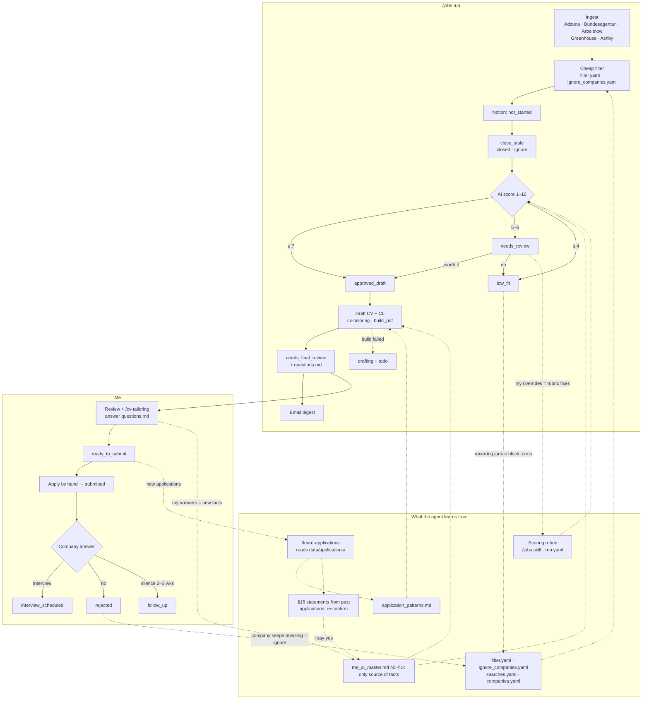

# jobAgent

A job and PhD search pipeline for one person. Python fetches postings from public job APIs, filters
and dedupes them and stores them in a Notion database. [Claude Code](https://code.claude.com/docs/en/overview)
scores them against your profile and drafts a tailored one-page LaTeX CV and cover letter. You review,
iterate and apply by hand. Nothing is submitted automatically and nothing runs on a timer.

No LLM API calls in Python: scoring and drafting run inside Claude Code (your Claude subscription).

Contents: [0. Setup](#0-setup) · [Privacy](#privacy) · [1. Every session](#1-every-session) ·
[2. After a run](#2-after-a-run-case-by-case) · [3. Iterating on a draft](#3-iterating-on-a-draft-with-claude-code) ·
[4. Cheat sheet](#4-cheat-sheet) · [5. How the agent improves](#5-how-the-agent-improves)

Agent-facing reference (sources, adapters, Notion schema): [`newusers.md`](newusers.md).

# 0. Setup

Needs: Docker, VS Code with the Dev Containers extension, a Notion account, a Claude subscription.

**On the host, once:**
```bash
git clone https://github.com/laloq11/jobAgent.git && cd jobAgent
```
```bash
cp .env.example .env
```
```bash
mkdir -p ~/.claude ~/.ssh && touch ~/.claude.json
```
The devcontainer mounts these three paths (Claude Code login, SSH keys for `git push`) and reads `.env`;
it does not start if one is missing.

**Notion:** duplicate the [Notion template](https://app.notion.com/p/6040006209cd827db8e6811839ea7e83?v=a700006209cd837199a908d6dea8e8c3&source=copy_link) into your workspace (or create a database with
the properties listed in [`newusers.md` → "What do I need from Notion"](newusers.md#what-do-i-need-from-notion)), create an
integration at [notion.so/my-integrations](https://www.notion.so/my-integrations), connect it to the
database, and put `NOTION_TOKEN` and `NOTION_DB_ID` into `.env`. Optional keys (Adzuna, SMTP for the
digest email) are explained in `.env.example`.

**In VS Code:** `Dev Containers: Reopen in Container`. Then, inside the container:
```bash
python3 -m jobs_agent.scripts.init_user
```
This creates your private, git-ignored `data/` folder from the examples and turns on the privacy
pre-commit hook. Then fill in:

| File | What |
|---|---|
| `data/private_patterns.txt` | Strings that must never be committed: your name, email, phone, student id |
| `data/info/me_ai_master.md` | Your profile: the only source of facts for scoring and drafting (template with §0–§15) |
| `data/info/cv_industry.tex`, `cv_academic.tex`, `letter_template.tex` | Your CV and letter layouts (fictional examples to replace) |
| `data/profile/*.yaml` | What to search for: keywords, locations, companies, feeds ([settings](#settings)) |

Check everything (files, LaTeX, Notion access and column types):
```bash
python3 -m jobs_agent.scripts.setup_check
```
```bash
python3 -m jobs_agent.scripts.run_ingest --dry-run
```
`--dry-run` fetches for real but writes nothing. Then start `claude`, log in once, and run `/jobs`.

# Privacy

Everything personal stays in `data/` and `logs/`, both git-ignored: profile, CVs, drafts, search
config, URL cache, posting texts. `.githooks/pre-commit` (enabled by `init_user`) refuses a commit that
stages anything under `data/` or `logs/`, a `.env`, a PDF / Word / image / `.db` file, or an added line
containing a string from `data/private_patterns.txt`. `git commit --no-verify` skips the hook, so
don't use it here.

# 1. Every session

| Where | Command | What it does |
|---|---|---|
| Host | VS Code → `Dev Containers: Reopen in Container` | Start the devcontainer |
| Container | `claude` | Start Claude Code in the repo |
| Claude Code | `/jobs` | Full run: ingest → close expired → score → draft → report + email |
| Claude Code | `/jobs --skip-ingest` | Same without fetching new postings (score + draft what is in Notion) |
| Claude Code | `/jobs --no-drafts` | Ingest + score only, no CV / letter |
| Claude Code | `/jobs --phd-search` | Also run the PhD web search (uses subscription usage, at most once per 7 days; guide: `jobs_agent/websearch/README.md`) |

Then: read the email and go through Notion with section 2. The email has, top to bottom:
1. **Run report** (Claude): what was checked, why the scores, what I need to decide.
2. **My todos (whole pipeline)**: drafts to review, postings to decide, failed drafts, applications to send, applications without answer for 14+ days.
3. **Backlog**: unscored rows left and how many more `/jobs` runs that takes; `approved_draft` rows waiting for a draft.
4. **Missing files**: drafts in Notion whose CV / letter PDF is not on disk.
5. **Jobs from this run**: table with posting and Notion links.

The subject line sums it up: `N draft(s) to review · N to decide · N unscored left`.

# 2. After a run: case by case

Work top to bottom. "Next run" = the next `/jobs` or `/jobs --skip-ingest`.

### Before any draft exists

| Case | In Notion | Then |
|---|---|---|
| `needs_review` (score 5–6) and I want it | Status → `approved_draft` | Drafted next run. Want it now: `/cv-tailoring <Notion page id>` |
| `needs_review` and I don't want it | Status → `low_fit` | Nothing. It is never drafted |
| `approved_draft` (score ≥ 7) but I don't want it | Status → `low_fit` **before the next run** | Only `approved_draft` rows are drafted |
| `low_fit` but I actually want it | Status → `approved_draft` | Drafted next run |
| Never this company again | Status → `low_fit` | Add the name to `data/profile/ignore_companies.yaml` with a comment why. Its other open rows become `ignore` at the next run |
| Never this kind of job (e.g. a title word) | Status → `low_fit` | Add the word to `block:` in `data/profile/filter.yaml`. Matches title + start of description, so use words that only appear in titles |
| Posting is gone / expired | Status → `closed` | Nothing (the next run also closes rows older than 60 days) |
| Scores keep being wrong in the same way | Change the status by hand | Tell Claude the pattern ("rates X too high") so the rubric in `.claude/skills/jobs/SKILL.md` or `phd.yaml` gets fixed |

Example: Notion shows "Account Manager Simulation – Score 7". Not for me → set `low_fit`; and if
these keep coming, add `Account Manager` to `block:` in `filter.yaml`.

### A draft exists (`needs_final_review`)

| Case | In Notion | Then |
|---|---|---|
| Draft ready | — | Open `build/cv_*.pdf`, `build/cl_*.pdf` and `questions.md` in the folder from `cv_path` |
| Something to change / questions to answer | — | Iterate with Claude Code → section 3 |
| Happy with it | Status → `ready_to_submit` | — |
| After reading it I don't want the job after all | Status → `low_fit` | The folder in `00_drafts/` can stay or be deleted |
| `drafting` + `todo: draft failed …` | Read `todo` | Fix the reason, then status → `approved_draft` (retry next run) or `/cv-tailoring <Notion page id>` now |

### After applying

| Case | In Notion | Then |
|---|---|---|
| Applied on the company site | Status → `submitted`, fill `Application Date` | Optional: move the folder from `00_drafts/` to your own archive folder in `data/applications/` |
| They answer | `1st answer` = Yes / No | — |
| Interview | Status → `interview_scheduled`, fill `1st interview` | — |
| Rejected | Status → `rejected` | Rejected several times by one company → `ignore_companies.yaml` |
| No answer after 2–3 weeks | Status → `follow_up` | Send a short follow-up email myself |

# 3. Iterating on a draft with Claude Code

Start revise mode with the draft folder (the path is in Notion `cv_path`, without `/build/...`):

```
/cv-tailoring data/applications/00_drafts/2026-11-17_acme_simulation-engineer
```

Claude lists the open questions from `questions.md`. Then ask for changes in plain words, one at a time,
in the same session. Each change is applied, both PDFs are rebuilt and checked (1 page, no warnings),
and Claude says what changed. Examples:

| Goal | What I type |
|---|---|
| Answer open questions | `Q1: yes, the test automation was mine. Q3: no publications.` |
| Letter shorter / different focus | `Letter: shorten paragraph 2 to three sentences and lead with the thesis.` |
| Change the opening | `Letter: rewrite the first sentence, less generic, name their simulation team.` |
| Reorder CV content | `CV: put the thesis project first in Key Projects.` |
| Different positioning | `CV: use the thermal / CFD-forward headline from §13.` |
| Wrong track | `This is a PhD position: switch to the Track B template and write a motivation letter.` |
| Too long | `CV: make it fit one page; drop the weakest bullet of my oldest job.` |
| Keyword from the posting missing | `Mention the Python automation in my first job, it is in the posting.` |
| New true fact about me | Claude proposes a line for `me_ai_master.md`; answer `yes` to add it, so future drafts use it |

Rules that still apply: nothing invented (only `me_ai_master.md` §0–§14, or facts I confirm in the
chat), one page, and the fixed rules in `me_ai_master.md` §0.
When it looks right: Notion status → `ready_to_submit`.

New posting that is not in Notion (pasted description or URL): `/cv-tailoring` + paste it; Claude asks
its questions first, then drafts.

# 4. Cheat sheet

## Commands (occasionally)

| Where | Command | What it does |
|---|---|---|
| Host | VS Code → `Dev Containers: Rebuild Container` | After any `.devcontainer/Dockerfile` or `requirements.txt` change |
| Container | `python3 -m jobs_agent.scripts.setup_check` | Check files, LaTeX, Notion columns |
| Container | `python3 -m pytest -q` | Offline tests |
| Claude Code | `/cv-tailoring <Notion page id \| draft folder \| pasted posting>` | Draft one posting, or revise an existing draft |
| Claude Code | `/learn-applications` | Learn from past applications → `application_patterns.md` + §15 questions (monthly) |
| Container | `python3 -m jobs_agent.scripts.run_ingest --dry-run` | Show what would be inserted, write nothing |
| Container | `bash jobs_agent/scripts/phd_websearch.sh` | PhD web search by hand (`--force` ignores the 7-day guard); then `run_ingest --adapters websearch [--dry-run]` (a plain `run_ingest` never includes it) |
| Container | `python3 -m jobs_agent.scripts.run_ingest --adapters greenhouse --dry-run` | Test one source |
| Container | `python3 -m jobs_agent.scripts.run_ingest` | Ingest only (no scoring), writes to Notion |
| Container | `python3 -m jobs_agent.scripts.close_stale` | List expired / ignored rows (dry-run); `--confirm` writes |
| Container | `python3 -m jobs_agent.scripts.pending unscored --limit 5` | See rows still waiting for a score |
| Container | `python3 -m jobs_agent.scripts.run_notify --send-empty` | Send the digest email now (last 24 h) |
| Container | `python3 -m jobs_agent.scripts.probe_greenhouse` / `probe_ashby` | Check which `companies.yaml` names have a job board |
| Container | `python3 -m jobs_agent.scripts.cleanup_notion` | List `not_started` rows to trash (dry-run); `--confirm` trashes |

`pending`, `update_row`, `build_pdf` are called by `/jobs` itself.

## When to come back

| When | What |
|---|---|
| 2–3× per week | `/jobs`, then section 2 |
| After the email | `needs_final_review` first, `Deadline` column first |
| Weekly | `submitted` rows older than 2–3 weeks → `follow_up` |
| Monthly / after many new applications | `/learn-applications`, then answer the §15 questions in `me_ai_master.md` |

Tip: one Notion view per step (`needs_final_review`, `needs_review`, `ready_to_submit`, `submitted`,
`follow_up`), sorted by `Deadline`, then `Fit Score`.

## Settings

| File | Controls |
|---|---|
| `data/profile/run.yaml` | `score_threshold` (7), `review_threshold` (5), `max_score_per_run`, `max_drafts_per_run` |
| `data/profile/filter.yaml` | `allow` / `block` keywords, matched over title + first 500 chars of description + notes |
| `data/profile/ignore_companies.yaml` | Companies never shown again |
| `data/profile/phd.yaml` | PhD aims: topics, exclusions, location, contract (Track B scoring) |
| `data/profile/feeds.yaml` | RSS job feeds (e.g. a university job portal) |
| `data/profile/watch.yaml` | Dream-target group pages watched for changes |
| `data/profile/cea.yaml` | CEA theses: categories / title keywords that get a detail-page fetch |
| `data/profile/jobsacuk.yaml` | jobs.ac.uk PhD searches (one keyword per search) |
| `data/profile/websearch.yaml` | PhD web search: model, usage cap, limits, 7-day guard, portals, Indeed countries, sites that need the original page (guide: `jobs_agent/websearch/README.md`) |
| `data/profile/companies.yaml` | `allow:` companies watched on Greenhouse / Ashby (all their jobs, any location) |
| `data/profile/searches.yaml` | Adzuna / Bundesagentur searches: keyword + city + radius |
| `data/info/me_ai_master.md` | Only source of facts for scoring and drafting |

## Statuses

| Status | Meaning | Set by |
|---|---|---|
| `not_started` | New, not scored | ingest |
| `approved_draft` | Score ≥ 7, will be drafted (or set by hand) | AI / me |
| `needs_review` | Score 5–6, I decide | AI |
| `low_fit` | Score ≤ 4, or I dropped it | AI / me |
| `drafting` | Draft started; if it stays there, `todo` says why it failed | AI |
| `needs_final_review` | CV + letter ready for me | AI |
| `ready_to_submit` → `submitted` → … | My manual steps | me |
| `rejected` | Company rejected me | me |
| `closed` / `ignore` | Posting expired / company on ignore list | `close_stale` / me |

# 5. How the agent improves

Solid arrows: one `/jobs` run and my steps. Dotted arrows: where my feedback goes so the next run is better.



Four loops: **facts** (answers and re-confirmed statements go into `me_ai_master.md`), **input quality** (block terms, ignored companies), **scoring** (my overrides fix the rubric), **style** (`/learn-applications` turns my past applications into `application_patterns.md`).

# License

MIT, see [`LICENSE`](LICENSE).
